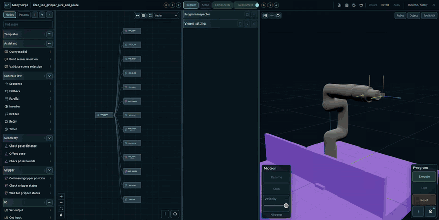

<p align="center">
  
</p>

<h1 align="center">ManyForge</h1>

<p align="center">
  <b>Program robot arms visually. Run the same Program in simulation and on the real robot.</b><br>
  A vendor-neutral manipulation framework built on ROS 2.
</p>

<p align="center">
  
</p>

## DISCLAIMER

This software is released under the Apache 2.0 license (see [LICENSE](LICENSE)
and [NOTICE](NOTICE)).

**Safety notice:** ManyForge does **not** implement functional safety. You
**must** integrate appropriate safety measures compliant with local
regulations, including hardware emergency stops and safety-rated controls,
and perform a risk assessment before deploying on real hardware.

**Pre-1.0:** ManyForge is under active development; interfaces and file
formats may change between minor releases.

---

## What is ManyForge?

ManyForge brings the way industrial robots are programmed together with ROS 2
and modern motion planning. You build a **cell** from components (arms,
grippers, I/O devices, sensors), compose a **Program** as a behaviour tree in
the Composer, and execute it with collision-checked motion planning, proper
Stops and live monitoring. The same Program runs on every lane:

| Lane | What runs | Use it for |
| --- | --- | --- |
| **Mock** | Simulated ros2_control hardware, no simulator or robot | Authoring, offline checks, CI |
| **Isaac** | A scene open in NVIDIA Isaac Sim, through its ROS 2 bridge | Physics, perception and full-cell rehearsal |
| **Real** | The robot through its vendor driver | Production, with the integrator's safety system |

Every lane goes through ros2_control and the stock joint trajectory
controller, so what you rehearse in Mock or Isaac is what the robot executes.

### Highlights

- **Composer**: a browser-based editor for Programs, Scenes and Deployments,
  with a live 3D view of the cell.
- **Behaviour-tree Programs**: sequences, fallbacks, parallels, retries and
  timers, plus motion, gripper, I/O, geometry and vision nodes.
- **Motion you can trust**: RoboPlan planning with collision checks before
  dispatch and runtime collision monitoring, within the vendor's TCP speed
  limits.
- **Stops, holds and recovery**: operator Stops per motion group, rules on
  signals (light curtains, part-lost), retries and operator recovery.
- **Components, not code**: arms, grippers, I/O devices and sensors are
  configured in a Deployment; a Program runs on any compatible Deployment.
- **Optional AI assistant**: an OpenAI-compatible model can edit the Draft
  through the Composer's tools; you review and Apply.

### Supported robots and tools

- **UFACTORY**: Lite 6 and UF850 in Mock, Lite 6 in Isaac, and
  xArm-family robots on Real through the vendor driver (Lite 6 tested on
  hardware), with their controller and tool I/O.
- **Universal Robots**: UR5 and UR10e in Mock, UR10e in Isaac; a UR5e model
  is included.
- **Grippers**: UFACTORY Lite gripper (pneumatic) and xArm gripper, Robotiq
  2F-85 and 2F-140, and generic valve-driven pneumatic grippers.

Other robots are added as components with a vendor adapter; see
[Adding a component](docs/authoring/ADDING_A_COMPONENT.md).

## Quick start

Follow the [workbench guide](docs/operations/DEVELOPMENT_WORKBENCH.md) for
host prerequisites. From the repository root, build the ROS image once (and
again after Dockerfile changes), then start:

```bash
./scripts/compose-dev.sh build
./scripts/compose-dev.sh start --project examples/mock_lite6_pick_and_place.scenario
```

Open **http://localhost:3000**, press **Execute**, then **Run**: the Lite 6
picks the part and places it.

- The first build and the first start take a while; later starts are
  incremental. On a Jetson (Thor, Orin), `build` selects NVIDIA's
  `noble-jetpack` package suite by itself.
- Omit `--project` to start with an empty workspace.
  `./scripts/compose-dev.sh status` inspects the workbench and
  `./scripts/compose-dev.sh stop` stops it. Starting the workbench does not run
  its test suite or authorize robot motion.
- The [examples](examples) folder has about 30 Scenarios: `mock_*` run
  anywhere, `sim_*` need Isaac Sim, `real_*` need the robot.

### Real robots

Machine facts (robot addresses, extra project folders) go in a site settings
file, `{"schema":"manyforge.site.v1","device_addresses":{"lite6_main":"192.168.1.31"}}`;
export its absolute path as `MANYFORGE_DEV_SITE_SETTINGS` before `start`.
Scenarios name the address key, never the address. Physical robot use
requires attended sessions and the integrator's own safety system; a
simulated run does not qualify a physical robot. See
[Real robot setup](docs/operations/REAL_ROBOT_SETUP.md).

### Isaac Sim

Open the matching scene with its ROS 2 bridge and Simulation Interfaces in
Isaac Sim separately, then load the corresponding `sim_` Scenario. The
workbench does not start Isaac or load the world. Use the same
`ROS_DOMAIN_ID` on both machines and leave `ROS_AUTOMATIC_DISCOVERY_RANGE`
unset (`SUBNET`) so the two hosts discover each other. Keep Isaac at about
real time: the arm controllers follow wall-clock time. A simulation that is
not playing never blocks Activate or Execute; its robots show **Simulation
not playing** and refuse new motion until it plays.

## Using ManyForge

A Scenario project contains the Program, Deployment, assignment and
referenced assets.

- **Save** persists authored changes; **Apply** makes the selected
  configuration available to the runtime.
- **New** empties the cell and opens the read-only "Untitled" Scenario:
  compose and Apply at once, then **Save As** to name and place it.
- **Load** is New, then Apply of the chosen Scenario; its components come up
  prepared, not enabled.
- **Execute** starts the Program (**Activate and execute** prepares and
  enables every active component first). Every Program starts held: press
  **Run** on its motion groups to move.
- Inspect component states and **Runtime/history** before issuing motion; every
  component action and Load/Apply outcome is recorded there. Do not infer
  command success from a lost connection.

Configured host project folders appear in Composer as `/projects/<name>`. Use
the displayed container path or a relative path in the picker, not a pasted
host path. After changing configured folders, stop the workbench and start it
again to update their mounts. See
[Project folders](docs/operations/DEVELOPMENT_WORKBENCH.md#project-folders).

Previous session journals are kept under the workbench's runtime state root;
retention is limited, see the
[session note](docs/operations/FRESH_CHECKOUT_CHECKLIST.md).

The optional Composer AI tab uses your OpenAI-compatible model server,
configured through an `ai_model` component and an assistant profile. See the
[assistant setup guide](docs/operations/ASSISTANT_E2E_COOKBOOK.md).

The [documentation index](docs/INDEX.md) covers the workbench, authoring and
API references; the [interrupts guide](docs/authoring/INTERRUPTS.md) explains
signals, node rules and global rules.

## Architecture

The Program runner orchestrates Program nodes. The ROS-free execution kernel
owns motion execution and Stop semantics; ManyForge's collision layer
validates and monitors motions. Deployment and component owners manage the
selected configuration and component lifecycle; vendor specifics live in
vendor adapters, so the core stays vendor- and lane-neutral. Composer presents
and edits those owners' state; it is not the authority for robot motion. See
[Architecture](docs/reference/ARCHITECTURE.md).

## Safety

ManyForge does **not** implement functional safety. Its software Stops,
command gates and acknowledgement controls are not safety-rated functions.
Integrate appropriate safety measures compliant with local regulations,
including hardware emergency stops and safety-rated controls, and perform a
risk assessment before using real hardware. Robot safety must be handled by
separate hardware or controller-level solutions. Closing the browser does not
stop the runtime.

## Versioning, releases, security

- **Version:** [VERSION](VERSION) (SemVer). Every package declares the same
  version; `./scripts/ci/verify-version-sync.sh` checks it.
- **Release notes:** [CHANGELOG.md](CHANGELOG.md). Releases are `vX.Y.Z` tags
  on `main`: `v0.1.0`, then `v0.2.0`.
- **Pinned companions:** a release builds the UFACTORY xArm driver from the
  fork `pastoriomarco/xarm_ros2`, branch `lyrical-no-gazebo`, at the commit in
  `Dockerfile.ros-lyrical-full` (`XARM_SOURCE_COMMIT`) and
  `manyforge_xarm_control/vendor/driver.yaml`; for `v0.2.0` that is
  `46aa1147d99963a8357b89744633db428746667b`. The release procedure is in
  [CONTRIBUTING.md](CONTRIBUTING.md#releases).
- **Security:** report vulnerabilities as described in
  [SECURITY.md](SECURITY.md), not in public issues.

## Contributing and project information

See [CONTRIBUTING.md](CONTRIBUTING.md) for development and test instructions.
Agents should also read [AGENTS.md](AGENTS.md). Feedback is welcome: open an
issue or a pull request.

ManyForge is licensed under Apache 2.0; see [LICENSE](LICENSE) and
[NOTICE](NOTICE).
